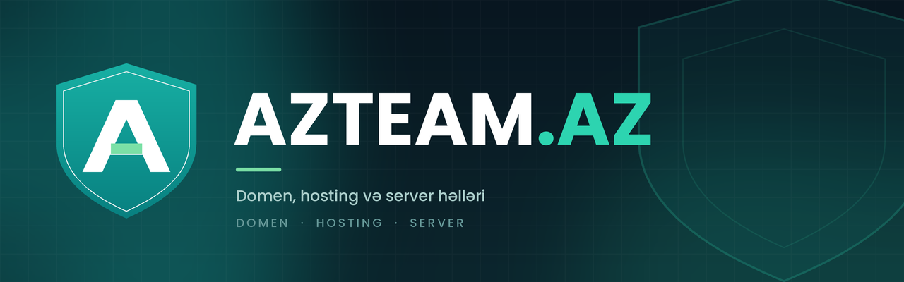

 

  

<h1 align="center">AzTeam</h1>

  <strong>Technology. Innovation. Development.</strong>

  Building digital experiences, reliable infrastructure and practical technology solutions.

  <a href="https://azteam.az">Website</a> ·
  <a href="https://azteam.az/elaqe">Contact</a> ·
  <a href="https://github.com/azteamaz">GitHub</a>

---

## About AzTeam

**AzTeam** is a technology brand focused on web development, digital platforms, hosting infrastructure and software solutions.

We work to make technology more accessible, reliable and useful through practical digital products and services.

## What We Do

- **Web Development** — Modern websites and web-based applications.
- **Hosting & Infrastructure** — Hosting services, servers and infrastructure solutions.
- **Software Development** — Digital products and custom software solutions.
- **Technology Projects** — Research, experimentation and development of new ideas.

## Our GitHub

This organization is the official GitHub home of AzTeam.

Here you can find:

- Open-source projects and public repositories.
- Development tools and resources.
- Documentation and technical examples.
- Projects and experiments from the AzTeam ecosystem.

## Our Vision

To build useful technology, develop reliable digital solutions and contribute to the technology community.

---

  <strong>AzTeam</strong> 
  Technology. Innovation. Development.
    
  <a href="https://azteam.az">azteam.az</a>

